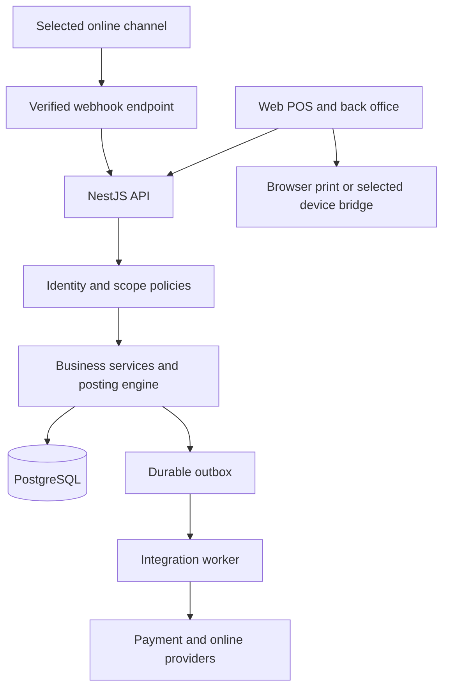
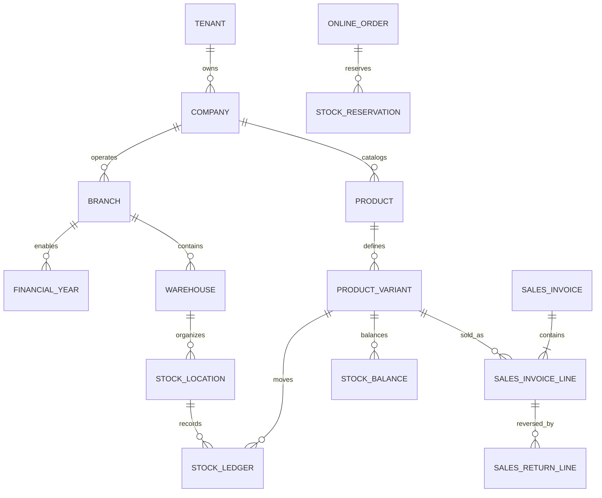

# Technical manual

**Version:** 0.1 | **Updated:** 21 October 2026  
**State:** Design baseline. Every component and command below is **Planned** unless explicitly marked otherwise. No application, package manifest, SQL objects, API endpoints or deployment currently exist.

This manual serves developers, database operators and support/operations. Update each section to **Implemented** with actual version/change references, then **Verified** with test/environment/date evidence. Do not turn proposed paths or commands into claims about the current repository.

## 1. Stack and version policy

| Layer | Proposed choice | Rationale / status |
| --- | --- | --- |
| Runtime | Supported Node.js LTS, TypeScript strict mode | Stable production lifecycle; verify supported releases at scaffolding |
| API | NestJS modular monolith, Fastify adapter after compatibility check | Modules, DI, controllers, guards, pipes and OpenAPI boundaries |
| ORM/driver | Drizzle ORM with node-postgres | Typed PostgreSQL access with explicit SQL/transaction control; no runtime schema execution |
| Database | Supported stable PostgreSQL | Relational integrity, sequences, exact numerics, transactions and row security |
| Web | React/TypeScript, React Router framework in SPA mode, Vite | Authenticated POS/back office; no SEO/SSR requirement for these screens |
| Client data/forms | Typed API client; choose cache/form libraries at scaffolding | Avoid committing to unnecessary dependencies before UI validation |
| Background work | PostgreSQL outbox/inbox and durable job records initially | Atomic recording of integration work; introduce a broker only when justified |
| Deployment | Separate API/web artifacts; one origin via proxy preferred | Provider/region/container and database hosting choices remain open |

React Router's [SPA mode](https://reactrouter.com/how-to/spa) supports a browser application served as static assets. Vite is its build tooling rather than the application framework itself. React also documents [Vite-based TypeScript setup](https://react.dev/learn/build-a-react-app-from-scratch).

NestJS documents [Drizzle integration](https://docs.nestjs.com/data/drizzle). Drizzle describes [several migration workflows](https://orm.drizzle.team/docs/migrations); this project selects a SQL-first process with manual operator execution. Neither choosing Drizzle nor declaring schema mappings authorizes running its schema-changing tools.

Do not freeze a claimed “latest” version from a draft. At scaffolding, check official stable releases and compatibility across Node, NestJS/adapter, React/Router/Vite, TypeScript, Drizzle/driver and PostgreSQL; record exact selected versions and verification date here, pin dependencies and commit the lockfile. Use no prerelease in production merely for novelty. Consult the [Node release lifecycle](https://nodejs.org/en/about/previous-releases).

## 2. Architecture and module boundaries



The diagram describes future components. Client applications never connect directly to PostgreSQL. Controllers cannot bypass service invariants by calling unrestricted table operations.

Proposed module responsibilities:

| Module | Owns |
| --- | --- |
| Organization | Retailers, companies, branches, branch-enabled financial years |
| Identity/access | User sessions, company profiles, employees, roles, membership and policy evaluation |
| Configuration | Parameter definitions/values, validation, inheritance and gate evaluation |
| Catalog/parties | Product/variant masters, units, barcode mappings, common parties |
| Locations | Warehouse level definitions, location tree and effective availability type |
| Inventory | Movement ledger, balances, reservation and valuation/posting primitives |
| Purchasing | PO, GRN, supplier invoice/return and document matching |
| Sales/POS | Held carts, checkout, invoices, returns and exchanges |
| Payments/shifts | Tender/payment/refund state, cash shifts and reconciliation |
| Pricing/tax | Effective price/rule selection, exact calculations and snapshots |
| Vouchers | Type registry, branch/year/series allocation and safe initialization |
| Online/integrations | Channel mapping, inbox/outbox, fulfillment and exceptions |
| Reporting/audit | Authorized read models, exports and business audit |

Use cross-module services for workflows rather than duplicating stock or authorization logic. Reports read committed business data/read models; they do not become another posting engine.

### Planned source structure

```text
apps/
  api/src/
    modules/<feature>/
      dto/                 # input/output contracts and validation
      controllers/         # routes and response mapping
      services/            # orchestration, invariants, transaction boundary
      repositories/        # scoped typed queries using supplied transaction
      policies/            # record/action rules where module-specific
    common/                # guards, filters, interceptors, request context
    database/              # connection/mappings only; no migration runner
  web/app/
    routes/                # React Router route modules
    features/<feature>/    # screens, forms and workflow components
    components/            # shared accessible components
    lib/                   # typed API, session and formatting helpers
packages/
  contracts/               # safe shared API types; no server secrets/ORM objects
database/                  # manually reviewed SQL policy and future scripts
docs/                      # maintained documents and decisions
```

Only `database/` documentation and `docs/` currently exist. Framework-generated conventions may refine this structure at implementation; record the actual structure afterwards.

### Request lifecycle

Request ID/logging → transport/body limits → authenticated principal → validated tenant/company/branch membership → action policy → DTO/parameter validation → controller → service transaction → repository → safe response/error mapping.

Middleware handles request metadata, not authorization-sensitive business logic. Guards/policies enforce scope/action. Pipes validate. Interceptors handle cross-cutting response/timing concerns. Exception filters map errors without exposing SQL, stack traces or secrets.

## 3. Ownership and required columns

**D-02/03 are proposals pending resolution before final DDL.** The following keeps all requested columns while avoiding artificial branch/year ownership for shared masters.

Every application table has:

| Field | Proposed representation and rule |
| --- | --- |
| Descriptive primary key | `bigint`, one explicit named sequence, `DEFAULT nextval(...)`; e.g. `party_id`, `sales_invoice_id`, `role_permission_id` |
| `tenant_id` | Required on retailer-owned records; tenant root's PK supplies its own tenant scope; NULL only on explicitly platform-global definitions |
| `comp_id` | Required on company-owned data; company root's PK is also company scope; NULL on explicitly tenant/global records |
| `branch_id` | Required on branch-owned data; branch root's PK is also branch scope; NULL on shared masters/global definitions |
| `fyear_id` | Required on voucher headers/details and year-scoped records; year root's PK is also its year scope; NULL on continuous masters/stock balances |
| `created_by` | User/system actor reference, normally required after bootstrap; never accepted as an arbitrary client identity |
| `created_date` | Required `timestamptz`, database/server UTC creation timestamp |
| `updated_by` | Last actor; NULL until first update; immutable movement/audit rows stay NULL |
| `updated_date` | Last-change `timestamptz`; NULL until first update |

The root key `comp_id`, `branch_id` or `fyear_id` is not duplicated to satisfy the column rule. It serves both identity and scope. Mapping/detail/audit/configuration tables also need their own descriptive sequence PK and all common columns.

| Record scope | Example | Company / branch / year meaning |
| --- | --- | --- |
| Platform | Built-in permission/parameter definitions | All three may be NULL; accessible only through explicit platform/shared-definition policy |
| Retailer | User principal, tenant-level defaults | Company/branch/year NULL; grants are resolved through membership/profile rows |
| Company | Party, style, variant, unit, company role | Company required; branch/year normally NULL |
| Branch | Warehouse, location, register, membership | Company/branch required; year NULL unless genuinely year-owned |
| Branch-year | Invoice, invoice line, GRN, voucher counter | Company/branch/year required; details exactly match header ownership |
| Continuous stock | Balance, reservation | Company/branch required; year NULL for balance and current reservation; source voucher/movements preserve posting-year context |
| Movement | Stock ledger, posted financial movement | Company/branch/year from source document; continuous reporting spans years |

A NULL scope field is never a wildcard granting access. Explicit record-type policies govern it. Use `NOT NULL` and scope-specific `CHECK` constraints where the table has a fixed scope. Avoid one ambiguous table containing all ownership types unless necessary for configuration/audit definitions.

Bootstrap procedure: the operator-reviewed reference-data script creates an audited system actor, using an explicitly documented deferred/self-reference or initial NULL actor exception. Subsequent seeds use that actor. No embedded production password or undocumented user ID zero. Record bootstrap provenance and prohibit the system actor from ordinary interactive login.

### Retailer and company identity

Proposed model: tenant-wide `app_user` principal for login, plus `user_company_profile` holding company, user type and exactly one employee/customer identity. Employee details extend an employee-classified party. Branch membership links a user/company profile to one or more roles in each branch. A single person can access multiple companies without duplicating their credentials; each company link is authorized separately.

Employee/customer radio buttons in user creation establish the selected company profile. A customer profile points to a customer-classified party; staff menus cannot be unlocked simply by changing a client-supplied user type. Policies evaluate the server-side profile and active company.

## 4. Logical data model

This is a conceptual inventory, not executable DDL or a finalized field dictionary. All entities inherit the required common fields under §3.

| Area | Main proposed tables / key fields |
| --- | --- |
| Organization | `tenant(tenant_id)`, `company(comp_id)`, `branch(branch_id)`, `financial_year(fyear_id, start_date, end_date, status)` scoped to branch |
| Identity | `app_user(user_id)`, `user_company_profile(user_company_profile_id, user_type, employee_id, customer_party_id)`, `employee(employee_id, party_id, department_id, designation_id)`, department/designation |
| Access | role, permission, role_permission, user_branch_role, user_permission_override, auth_session, MFA/recovery records |
| Parties | party, party_classification, party_contact, party_address; supplier/customer/employee roles can coexist |
| Catalog | product, product_variant, brand, category, size_group, size, color, unit, product_unit, variant_barcode |
| Configuration | parameter_definition, parameter_value; typed definition, allowed scopes, dependency, version |
| Locations | warehouse, location_level_definition, stock_location(parent_location_id, level_id, location_type_id), location_type |
| Inventory | stock_ledger, stock_balance, stock_reservation, stock_adjustment/header lines, stock_count/header lines, stock_transfer/header lines, optional tracking tables later |
| Purchasing | purchase_order/line, goods_receipt/line, purchase_invoice/line, purchase_return/line, receipt_invoice_allocation |
| POS | register, cashier_shift, held_cart/line, sales_invoice/line, sales_return/line, exchange_link |
| Payments | payment, payment_allocation, refund, shift_cash_movement, reconciliation_case |
| Numbering | voucher_type(voucher_type_id, voucher_type_code), voucher_series, voucher_counter |
| Online | sales_channel, channel_variant_mapping, online_order/line, fulfillment/line, integration_inbox, integration_outbox |
| Operations | audit_event, idempotency_record, import_batch/row, database_change metadata |
| Growth | price_list/line/scope, promotion/rule, loyalty_movement, store_credit_movement, gift_voucher/movement, supplier payment allocations |



### Keys, types and constraints

- Name tables/columns snake_case; descriptive primary keys, matching `*_id_seq` sequences owned by those columns. Sequence gaps are normal; never use IDs to promise consecutive invoice numbering. PostgreSQL documents [sequence behavior and gaps](https://www.postgresql.org/docs/current/sql-createsequence.html).
- Proposed `numeric(20,6)` money/quantities/factors, with validation of currency settlement scale and whole-piece items. Confirm bounds and precision in D-05. Use a decimal library server-side, never binary `number` arithmetic for authoritative totals.
- JSON bigint IDs and decimal amounts are strings, e.g. `"salesInvoiceId": "8123"`, `"grandTotal": "1499.00"`. Parse/validate explicitly; do not convert bigint IDs through JavaScript `Number`.
- Store audit timestamps as `timestamptz`; store `voucher_date` as branch-local `date`. Financial-year selection uses that business date and branch, not UTC date alone.
- Add version/optimistic-lock fields to mutable drafts/settings where needed; a stale update returns a conflict. Posted documents are not edited in place.
- Scoped unique keys include tenant/company as appropriate: style code, variant SKU, barcode, party code and voucher series. A variant's selected attribute combination is unique within its product.
- Foreign keys include ownership columns where feasible: an invoice line cannot reference another tenant/company's variant or another header's branch/year. Define exact allowed scope relationships for shared company masters versus branch rows.
- Avoid relying on default nullable-unique behavior for settings overrides or stock dimensions; use supported `NULLS NOT DISTINCT`, partial unique indexes or separate scoped tables after version selection. Define balances so “no batch/serial” cannot create duplicate buckets.
- Index high-volume access paths beginning with relevant scope: barcode/SKU, voucher number, document date/status, variant/location balances, original-sale return links, pending reservations, inbox/outbox state and audit timestamp.
- Critical posting links must enforce relational integrity. For example, use an explicit source-document/line reference design rather than an unconstrained string `source_type/source_id` pair as the only stock ownership guarantee.

### PostgreSQL row security

Proposed defense: explicit repository predicates/scoped foreign keys plus PostgreSQL row-security policies on retailer-owned tables. Verify runtime users are not table owners, superusers or BYPASSRLS. PostgreSQL describes those [row-security exceptions](https://www.postgresql.org/docs/current/ddl-rowsecurity.html).

Set authenticated tenant/company/branch context transaction-locally on the same checked-out connection used for queries. Never leave session-level scope values on pooled connections. Workers establish a verified job scope too. Missing context denies access; tenant-scoped/global definitions have separate policies. Test cross-tenant writes and reads with the actual runtime role, including pooled-connection reuse. RLS complements API action checks; it cannot infer cashier versus refund-authorizer permissions by itself.

## 5. SQL lifecycle and ORM boundaries

Follow [database/README.md](../database/README.md). SQL is the authoritative artifact. Drizzle mappings match the manually prepared schema and never create it on boot. An offline tool may help draft SQL, but the final file needs human review and manual execution.

Prohibited paths include schema push, runtime migration calls, startup DDL, test auto-sync, deploy-time object creation and automatic seeds. Runtime credentials receive necessary DML/sequence privileges only. Privileged ledger/audit insertion or reversal functions, if selected, are themselves manually reviewed SQL and do not grant general mutation rights.

Development/test provisioning also uses operator-executed scripts after authorization. Automated tests may manipulate approved isolated fixture data, but must not recreate tables or automatically install extensions. Static schema/mapping checks can run without database changes. Record which validations were possible.

On startup/readiness, compare a read-only schema/capability marker against supported application versions. An incompatible database causes an actionable readiness failure, not a silent attempt to migrate it.

## 6. Inventory, valuation and location model

The stock ledger is the movement truth. Current balances are transactionally maintained projections, rebuildable/reconcilable from movements. Balance repair is an operator-reviewed process, not an unlogged manual edit.

Proposed balance dimensions: tenant, company, branch, variant, leaf location and disposition; batch/serial dimensions join only when delivered. Reservations refer only to sellable stock and include owner/order, quantity, expiry and state.

```text
total physical on-hand = sellable + damaged + QC + other physical dispositions
available-to-sell = sellable on-hand - active reservations on sellable stock
in-transit = separately tracked quantities between dispatched and received states
```

Do not also subtract damaged/QC from the sellable subtotal. Ensure location type/disposition cannot disagree silently. A non-sellable ancestor makes descendants non-sellable; reparenting/classification changes with balances need a controlled move/reclassification plan and audit.

Primary-unit quantity equals transaction quantity × snapshotted positive conversion factor. Fractional results are rejected for whole-piece products. Batch/serial gates remain off until receipt, issue, transfer, counts, returns, reservations and reporting all support the feature.

Costing proposal D-04: moving weighted average for a company/variant cost pool, exact internal precision, outbound carrying-cost snapshots, original-issue-cost reversal on customer returns, and carrying-cost preservation across internal branch transfers. Finalization must define cross-branch timing, cost-pool locks, invoice cost variances, negative-stock exceptions and backdating. Backdating that would rewrite subsequent costs is blocked by default pending a controlled recosting design.

Physical counts need a scope freeze or a count snapshot plus movement reconciliation. A variance posts an adjustment; it never overwrites ledger quantities. Stock year rollover is reporting continuity, not a new receipt.

## 7. Posting, concurrency and idempotency

Use one service transaction for the complete local posting operation. Repositories receive its transaction handle; do not accidentally acquire a second connection mid-workflow.

### Local posting sequence

1. Authenticate and validate actor, company/branch/year, action, status, approvals and request shape. Reserve/lock the idempotency key for this scope/operation and compute a canonical payload hash.
2. Lock the draft/source, related eligibility quantities, valuation pool, affected stock/reservations and voucher counter in a documented consistent order. Aggregate repeated variant/location lines before availability checks. Handle first-balance creation safely with a unique constraint/upsert.
3. Revalidate live permissions, document version/open period, remaining return/receipt quantity, stock, prices, tax and any required manager authorization.
4. Allocate voucher number and write immutable header/line snapshots, movements/balances/cost effects, local tender/refund status, audit and outbox records.
5. Persist the completed idempotent result and commit. Response/printing happens afterwards. On failure the entire local operation rolls back.

Use atomic conditional updates or row locking with retry of the entire transaction for bounded deadlock/serialization failures. Concurrent allocation must not depend on a prior unlocked availability read. Return remaining quantity, refund capacity, serial state and voucher counters need their own atomic eligibility controls.

An idempotency record is unique per tenant/company/branch/operation/key. Same key + same canonical payload returns the original result; different payload returns conflict. Preserve financial deduplication even after routine HTTP-cache expiry through source uniqueness/provider references. A request in progress returns a status/polling response rather than creating another business operation.

### External payments

Do not hold database locks during provider network calls. Establish a checkout/payment attempt and, where needed, short-lived stock reservation. Call the provider with a stable idempotency reference; confirm outcome via verified webhook/server status. Then post or transition the local operation transactionally.

Provider capture cannot be rolled back by a PostgreSQL rollback. If a confirmed payment cannot be posted because the year closed, a reservation expired or another invariant fails, preserve the payment attempt as **reconciliation required**, reallocate/post if safely possible or issue an approved refund. Never hide a captured payment or force a negative-stock sale. Reconcile split-tender partial success explicitly; do not collect again just because the browser timed out.

Returns/exchanges commit their related local stock/documents together. Provider refunds may remain pending after local posting and must be visible separately. Cumulative refunds cannot exceed confirmed/recorded eligible payment less previous refunds.

### Durable integrations

Write outbox events in the same local transaction as the business effect. Workers claim jobs safely, retry with bounded backoff and retain exhausted jobs for operators. Incoming webhooks verify signatures, deduplicate provider event IDs and process out-of-order notifications using state/version checks. Network delivery is at-least-once; handler idempotency ensures one local business effect.

Internal last-unit protection cannot guarantee an external marketplace never oversells while stock messages are delayed. Measure channel lag, use agreed safety stock and expose oversell/refund exceptions. Do not promise a distributed transaction across providers.

## 8. Voucher and period controls

Keep three separate concepts:

- Table identity: descriptive bigint PK from a PostgreSQL sequence; never year-reset.
- Voucher business type: stable integer code, e.g. PO=1, GRN=2, purchase invoice=3, sales order=4, branch transfer=11; type table still has its own sequence PK.
- Voucher number: varchar displayed to users, scoped to company/branch/year/type/series.

Proposed numbering uses a locked transactional counter row, separate from primary-key sequences. Unique scope includes tenant/company/branch/year/type/series/number. Format proposal: branch-prefix/year/type/zero-padded counter; exact lengths/allowed characters and registration-level uniqueness require tax/business validation. Allocate only at posting. Cancelled numbers remain occupied.

The reset/setup screen initializes unused new-year counters or safely advances an existing series after validating all prior allocations. Reject lowering into used ranges, collisions, period mismatch and unauthorized changes. In the same active year, never renumber posted vouchers. Record before/after, reason and authorizer.

Branch years are explicit dated records. Posting-date checks apply to new documents, returns/credit notes, imports and integration jobs. Cross-year returns post in an authorized open period while retaining the original sale reference and financial allocation. Closing a year does not delete stock balances or reset PK sequences.

## 9. Configuration resolution and authorization

Parameter metadata: stable code, label/help, type, allowed scope, default, constraints/options, dependency/gate, visibility, change permission and version. Values are typed; secrets use protected secret references rather than generic plaintext settings.

Proposed order, considering only levels the definition allows:

`user-in-active-branch override → branch → company → tenant default → definition default`

The user override key includes active company/branch, avoiding a global preference accidentally enabling another branch. An absent row/value inherits; explicit false/zero does not. Removing an override restores inheritance. Definition defaults and parent gates bound effective values; a child cannot enable a disabled tracking capability. Cache by tenant/company/branch/user/version and invalidate on update. Audit old/new/effective source.

Permission evaluation: active membership + active-branch role grants + allowed individual grants − explicit user denies, then mandatory record/customer restrictions and approval limits. Reject unauthorized scope before record loading. Manager approval needs a separate authenticated approver with sufficient same-scope authority and a recorded reason; a UI checkbox is insufficient. Scope/role changes invalidate permissions promptly using membership/session versioning or equivalent server checks.

## 10. Authentication and application security

Proposed browser flow: short-lived signed access JWT held in memory and sent as Bearer authorization; opaque rotating refresh credential in a Secure, HttpOnly, appropriately scoped cookie. Store refresh hashes/session families server-side, rotate atomically, detect reuse, revoke on logout/reset/compromise and validate issuer/audience/algorithm/expiry/session status. Token lifetime and idle/absolute session limits are configuration chosen before implementation. Keep long-lived credentials out of browser localStorage.

Use same-origin deployment where possible, appropriate SameSite cookies, origin validation and CSRF protection on cookie-authenticated endpoints such as refresh/logout. Restrict CORS explicitly. Account for refresh across concurrent tabs without weakening replay detection. This follows the secure-cookie and session-lifecycle principles in the [OWASP session management guidance](https://cheatsheetseries.owasp.org/cheatsheets/Session_Management_Cheat_Sheet.html).

Use a vetted Argon2id password-hashing implementation with parameters benchmarked for deployment; never reversible password storage. Protect reset tokens with expiry/single use and rate limiting. Require production privileged-user MFA and protect recovery codes. See [OWASP password storage guidance](https://cheatsheetseries.owasp.org/cheatsheets/Password_Storage_Cheat_Sheet.html).

Additional controls: HTTPS, secure headers/CSP, request/file limits, parameterized queries, strict allowlists for editable/sort/filter fields, safe upload MIME/size handling, row-scoped object-storage access, CSV formula protection and safe template rendering. Keep secrets in deployment secret storage. Log correlation IDs without tokens/passwords/customer payload dumps. Payment providers handle card entry; never persist PAN/CVV.

Audit actions include login/security changes, permissions, tax/configuration edits, posting/reversal, refunds, overrides, adjustments, numbering reset and sensitive print/export. Append-only audit events include actor/scope/object/action/reason/correlation and redacted changes. Audit is distinct from ordinary debug/operational logs.

## 11. API conventions and example contracts

**Planned examples, not live endpoints.** `/api/v1` is the version prefix. Tenant context is derived from the authenticated principal; company/branch path values are validated against membership, never trusted automatically.

| Method and example route | Purpose / key checks |
| --- | --- |
| `POST /api/v1/auth/login` | Authenticate, rate limit and establish session |
| `POST /api/v1/auth/refresh` | Rotate refresh credential; CSRF/origin validation |
| `POST /api/v1/auth/logout` | Revoke session family as policy requires |
| `GET /api/v1/companies/{compId}/branches/{branchId}/variants?barcode=...` | Resolve company-scoped variant and authorized branch availability |
| `POST /api/v1/companies/{compId}/branches/{branchId}/checkouts` | Idempotent checkout; validate active shift/year, prices, payment and stock |
| `GET /api/v1/companies/{compId}/branches/{branchId}/checkouts/{checkoutId}` | Determine original attempt status after timeout |
| `POST /api/v1/companies/{compId}/branches/{branchId}/goods-receipts/{receiptId}/post` | Controlled one-time receipt posting |
| `POST /api/v1/companies/{compId}/branches/{branchId}/sales-returns` | Original-sale eligibility and refund capacity |
| `POST /api/v1/companies/{compId}/branches/{branchId}/exchanges` | Linked local return + replacement sale |
| `POST /api/v1/companies/{compId}/branches/{branchId}/voucher-series/{seriesId}/initialize` | Safe authorized new-year setup/advance |
| `POST /api/v1/integrations/{channelId}/events` | Provider signature, server-side channel-to-tenant mapping and event deduplication |

Posting requests carry `Idempotency-Key`; body includes business date, branch-valid `fyearId`, source/version where applicable and string IDs/decimals. Client-submitted totals are treated as expected values, not authoritative charges; return a conflict if recalculation requires cashier confirmation.

Example successful response shape:

```json
{
  "data": {
    "checkoutId": "7123",
    "salesInvoiceId": "8123",
    "voucherNo": "EXAMPLE-B01-2627-SI-000001",
    "status": "posted",
    "grandTotal": "1499.00",
    "currency": "INR"
  },
  "meta": { "requestId": "request-correlation-reference" }
}
```

The voucher string is illustrative, not a validated tax-number format. Standard error shape includes stable `code`, safe message, optional field errors and request ID. Use 400/422 for invalid input, 401 unauthenticated, 403 forbidden, 404 when scoped record is absent, 409 for stock/version/idempotency conflict, 429 for rate limiting and 5xx for server faults. Choose and document consistent 400 versus 422 semantics in OpenAPI. Pending asynchronous operations may return 202 and a status resource.

Use bounded pagination and allowlisted sorting/filters. Exports preserve filter/scope rules and use durable jobs for large datasets. Print/reprint authorization is checked server-side. Version schemas and test compatibility rather than exposing raw ORM entities.

## 12. Calculation and reporting rules

Create one backend calculation module reused by POS, online orders, returns and reports. Snapshot selected price list/rule, unit factor, quantity, tax basis, rate/components, discount allocation, rounded totals and issue cost at posting. Preserve exact internal decimals and settled minor-unit amounts.

Before implementation obtain approved fixtures for inclusive/exclusive tax, mixed items, line/bill discounts, proportional allocation, zero/negative totals, cash change, split payment, partial returns and cumulative refunds. Define residual-cent distribution so partial returns cannot over-refund the original line/invoice. Rates and classifications are effective-dated and must satisfy the retailer's current applicability review.

Gross profit uses net sales excluding tax less COGS with original-cost return reversal. Cost and margin access are separate permissions. Reports use posted documents and explicit date bases; settlement date versus invoice date is not silently mixed. Valuation/aging are separate concepts; weighted-average costing does not by itself define stock age.

The [official GST portal's GSTR-1 guidance](https://tutorial.gst.gov.in/userguide/returns/GSTR_1.htm) is a reference for reporting questions. Actual retailer invoice/credit-note rules, tax settings, numbering and any electronic-invoicing obligations require current validation before go-live. This manual specifies software controls, not a blanket compliance certification.

## 13. Setup, environments and deployment

**Current runnable setup: none.** Do not run guessed `npm install`, build or database commands against this documentation-only repository. Add verified commands after manifests and tooling exist.

Planned setup sequence:

1. Select/pin compatible versions and tooling; create actual workspace manifests and secret-free environment templates.
2. Prepare reviewed SQL and have the operator provision the explicitly authorized environment manually.
3. Configure runtime database role, secret references, API/web origin, session signing/refresh settings, timezone/currency defaults and provider sandbox credentials.
4. Install with the chosen lockfile, run actual lint/type/test/build commands and start API/web using the documented scripts.
5. Verify schema readiness, scoped user setup, sample catalog/stock and business scenarios before pilot use.

Configuration categories: database connection/pool limits; web/API origins; signing key IDs/secret references; session/rate/body limits; object storage; online/payment sandbox/provider secrets; worker retry/retention; logs/metrics; backup/PITR. Backend secrets never use public frontend environment-variable prefixes. Production user credentials are set through secure bootstrap/invitation, not committed seeds.

Separate development/test/staging/production databases and provider credentials. All use the same reviewed SQL history; production rollout may use additive expand/contract changes, with the operator applying each stage manually. Deployment pipeline builds/tests artifacts and checks readiness but does not execute DDL. Preserve the compatible prior application artifact for rollback; database rollback may require a forward fix or recovery and cannot be assumed automatic.

For SPA hosting, serve static assets with correct cache policy and route fallback, while proxying `/api` to the API. Restrict fallback so unknown API routes do not return the app HTML. Set TLS, request limits, health/readiness endpoints and graceful worker shutdown. Exact deployment/restore commands and provider-specific procedures remain pending D-11.

## 14. Operations and recovery

Monitor request error/latency, checkout outcomes, stock conflicts, payment/refund reconciliation, outbox lag/retries, online synchronization lag, DB connections/locks, failed login/MFA, backup age and restore drill results. Thresholds/owners are set with the selected hosting/load profile.

| Incident | Planned handling |
| --- | --- |
| Checkout timed out | Look up original key/attempt; return existing result or reconciliation state before any new payment |
| Paid but invoice not posted | Verify provider state, reserve/revalidate if possible, post original attempt once or approved refund; retain audit |
| Stock ledger/balance mismatch | Restrict affected posting scope if necessary, investigate source movements, reconcile with reviewed correction; do not edit ledger |
| Online event failed | View error, correct mapping/configuration and replay the original stable event safely |
| Printer unavailable | Reprint existing invoice after recovery; no new sale/payment |
| Schema incompatible | Keep readiness failed, identify missing operator-approved change and compatible release; no automatic fix |
| Suspected tenant leak | Revoke affected access, preserve evidence, contain scoped services and follow the assigned incident/privacy process |

Recovery proposal: encrypted scheduled backups plus point-in-time recovery where needed for RPO ≤15 minutes; RTO ≤4 hours pending hosting validation. A daily dump alone cannot meet the proposed RPO. Define retention, geographic/storage access, encryption/key custody and restore permissions.

Restore drill: identify recovery point → operator restores to isolated target → verify schema history/keys/ownership → reconcile ledger/balances/documents/payments → replay/reconcile external provider events safely → measure RPO/RTO → authorize cutover. A restored local DB does not undo externally captured payments or sent shipments. Preserve/reconcile provider IDs and outbox/inbox history before restarting workers. Record timed evidence before promising recovery objectives.

## 15. Verification and ongoing updates

| Check layer | Required focus |
| --- | --- |
| Static/build | Type safety, lint, secret-free config, API schema and SQL review |
| Unit/domain | Exact calculations, discount/return allocation, config fallback, scope/permission logic and state transitions |
| Integration | Operator-provisioned PostgreSQL; scoped constraints/RLS, postings, idempotency, concurrency, reversal and cost effects |
| End-to-end | Cashier flow, return/exchange, shift close, transfer/count, online order and error recovery |
| Security | Tenant/company/branch/customer boundaries, session reuse/revocation, ID tampering, exports/files/workers |
| Operational | Realistic load, hardware/printing, manual SQL rehearsal, backup restore and provider event replay |

Use AC-01–16 as the commercial baseline and AC-17/18 for optional units/tracking. Record datasets, runtime/database roles, versions, commands and results. Do not claim database/hardware verification when only static review was possible.

Update this manual when architecture, dependencies, schema/SQL history, endpoints, security, setup, deployment or recovery changes. Each implemented feature must also update the [user manual](05-user-manual.md), [checklist](03-task-checklist.md) and [changelog](CHANGELOG.md) as applicable.
